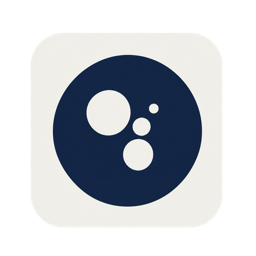

<div align="center">
  
  <h1>Remote Go</h1>
  <p>把 Chromecast 语音遥控器变成 Mac 上的 AI 控制器。</p>
</div>

在 Codex、Claude、Grok Bot 等应用中，用遥控器切换会话、触发听写和发送消息。Remote Go 支持可视化改键、按应用自动切换映射、预设文件导入／导出和方向键飞鼠。右上角的语言按钮可在简体中文和 English 之间切换。

**运行环境**为 Apple 芯片 Mac、macOS 15 或更高版本，以及支持蓝牙 HID 的 Chromecast 语音遥控器。可用按键取决于遥控器型号和固件。

## 安装

1. 从 [GitHub Releases](../../releases/latest) 下载 macOS ARM64 的 ZIP，解压后将 `Remote Go.app` 拖入「应用程序」。发布包使用临时签名，尚未经过 Apple 公证。如果 macOS 拦截下载的应用，也可以按下文从源码构建。[Apple 的应用安全说明](https://support.apple.com/zh-cn/102445)
2. 在 Mac 的「系统设置 → 蓝牙」中配对遥控器。需要进入配对模式时，按住遥控器的返回键和主页键，直到指示灯开始闪烁。[Google 配对说明](https://support.google.com/chromecast/answer/10109990)
3. 打开 Remote Go，选择 **Agent Coding**，开启「启用改键」。在「隐私与安全性 → 辅助功能」中授权 Remote Go。如无法读取按键，再检查「输入监控」；如需读取专用语音键，按提示允许蓝牙访问。
4. 试按方向键或确定键，确认窗口的「最近按键」发生变化。

## 默认操作

| 按键 | Agent Coding |
| --- | --- |
| 方向环、确定 | 方向键、Return |
| 圆点语音键 | 发出 Fn，通过遥控器麦克风使用微信听写 |
| 返回 | 在 Codex 或 Claude 中打开会话选择 |
| 主页 | 短按轮换最近三个 Codex 会话，长按切换预设 |
| 音量＋／− | Codex 或 Grok Bot 左栏上一项／下一项；在 Codex 长按音量＋查看用量 |
| YouTube／Netflix | 打开 Codex／Claude 并尝试聚焦输入框 |
| 静音 | Esc |
| 电源 | 短按暂停或恢复改键，需支持蓝牙电源键信号 |
| 信源 | 短按切换应用，长按一秒进入或退出飞鼠 |

飞鼠模式中，方向环移动指针，确定键点按，音量键滚动，返回键退出。退出时显示「飞鼠已退出」，提示条随后散成细小粒子。开启系统「减少动态效果」时只显示文字提示。用「按应用改键」自定义 WorkBuddy、豆包工作或其他已安装的 App。长按主页可切到「看视频」，使用 YouTube 播放、快进快退、字幕和全屏映射。

在「管理预设」中可导出 `.remote-go.json` 分享给社区。接收者先预览按键和按应用映射，再将文件导入为新预设。

[完整使用指南](docs/guide.zh-CN.md) · [更新记录](CHANGELOG.md) · [第三方资源](THIRD_PARTY_NOTICES.md)

## 微信听写

1. 单独安装 [BlackHole 2ch](https://github.com/ExistentialAudio/BlackHole#installation-instructions)，在微信输入法的「语音输入 → 麦克风」选择 **BlackHole 2ch**，把按住说话的快捷键设为 **Fn**。
2. 按住 Mac 键盘的 **Fn** 用 Mac 内建麦克风，按住遥控器的**圆点语音键**用遥控器麦克风。首次使用时，根据提示允许 Remote Go 访问麦克风。
3. 退出 Remote Go 后，如果还要直接用 Mac 键盘听写，在微信输入法里把麦克风切回「自动检测」或选 Mac 内建麦克风。

仅在微信输入法里选择 BlackHole。Mac 的系统默认输入和输出、以及腾讯会议等其他应用的音频设置都保持原样。

## 从源码构建

在 Apple 芯片 Mac 上安装 Xcode Command Line Tools 或 Xcode，然后在仓库根目录运行以下命令。

```sh
./build.sh
'./dist/Remote Go.app/Contents/MacOS/RemoteDesk' --self-test
open './dist/Remote Go.app'
```

脚本用 Swift 编译并进行本地临时签名，无需安装额外库。自检覆盖 HID 报告、按键连发、预设迁移、快捷键、ATVV 解码、双语文本和预设文件读写。蓝牙硬件与第三方应用的交互还需要在 Mac 上验证。应用更新后如果改键失效，可尝试重新授予辅助功能权限。

## 权限与数据

改键依赖 macOS 的辅助功能与输入监控。遥控器音频通过蓝牙接收，Remote Go 通过 BlackHole 把音频送给微信输入法转写。辅助功能、蓝牙和麦克风按功能授权。预设和最近的 Codex 会话 ID 保存在本机。用量面板通过已安装的 Codex CLI 查询当前账户配额。
